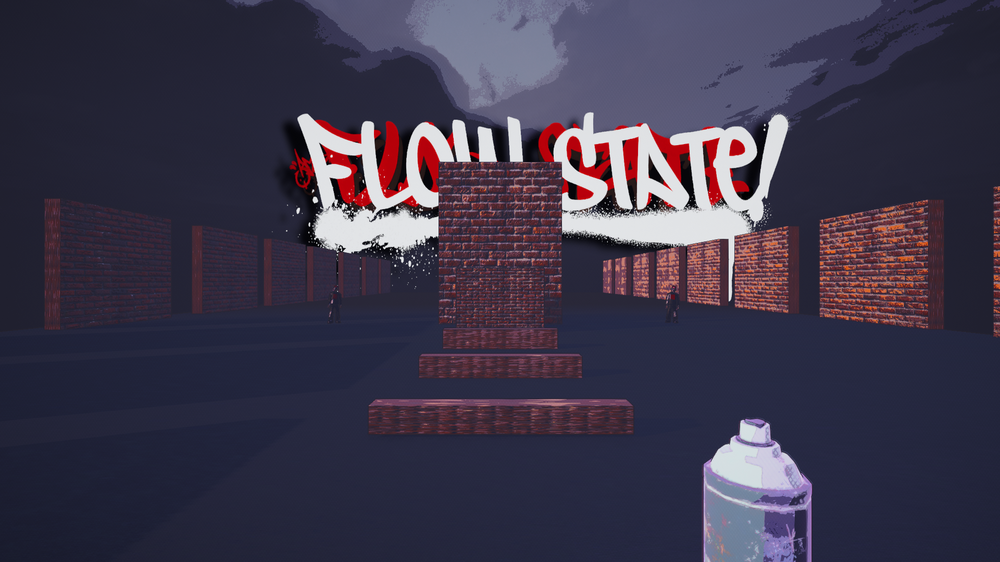

# FLOWSTATE — estudio de arte, iluminación y rendering

Fecha: 2026-10-28. Alcance: lectura de archivos, consultas de Editor en memoria y capturas; sin implementación de propuestas ni Play Mode. Unity 6000.0.41f1, URP 17.0.4, Shader Graph 17.0.4, Cinemachine 3.1.7 e Input System 1.13.1 confirmados en ProjectVersion y Packages. Estado observado: Gameplay, calidad PC, escena sin cambios pendientes de guardar. Los cambios ajenos en GraffitiPainter y GraffitiInteractionTests se preservan.

## Autoridad y estados

La [biblia inicial](../FLOWSTATE-Game-Art-Direction-Bible.md) y [Creative Direction](../../../.agents/skills/flowstate-creative-direction/SKILL.md) mantienen pilares y autoridad. Este informe no aprueba un nuevo estilo, bucle, nivel ni presupuesto. IMPLEMENTADO describe código/configuración/imagen; INTENCIÓN DOCUMENTADA expresa una fuente escrita; INTERPRETACIÓN identifica juicio; PROPUESTA requiere revisión; PENDIENTE DE VERIFICAR identifica evidencia ausente. Solo una autorización del desarrollador justifica APROBADO.

## Identidad que conservar

**INTENCIÓN DOCUMENTADA:** [FSSRS](../../../Assets/07_StylizedRendering/FSSRS/Documentation/FLOW_STATE_STYLIZED_RENDERING.md) concibe el mundo como impresión industrial incompleta: papel/tinta estructuran valores; cian, magenta, amarillo ácido y coral funcionan como placas emocionales. Graffiti debe conservar la capa más saturada y autoral. Punk es un énfasis temporal, no un filtro global permanente. Flecks y puntos halftone están desactivados deliberadamente en la dirección actual; no son funciones que deban encenderse para «completar» el estilo.

**IMPLEMENTADO:** materiales estilizados, perfiles/paletas, composite, hatching y contorno de personaje por placas. Industrial Dusk aporta cielo/niebla, principal cálida y relleno frío en la configuración observada. La relación entre recorrer, detenerse y pintar exige leer apoyo, superficie y encuadre, sin reducir el mundo a señalización luminosa uniforme.

**Discrepancias históricas:** el manual FSSRS aún menciona Game.unity, cámara LookDev exclusiva y cinco emociones; Gameplay observado usa el renderer FSSRS y el controlador actual tiene cuatro estados. Se documenta la discrepancia sin editar la fuente histórica ni convertirla en decisión nueva.

## Arquitectura comprobada

El [snapshot JSON](Editor-Rendering-Snapshot-2026-10-28.json) conserva lecturas explícitas y condiciones.

| Capa | Evidencia actual | Implicación |
|---|---|---|
| Escena/cámara | Assets/02_Escenas/Gameplay.unity; MainCamera FOV 62, HDR, SMAA, post activo, volume mask 1, renderer index 1 | Esta es la cámara de la captura directa; no demuestra cámara final tras inicialización |
| Pipeline PC | Assets/Settings/PC_RPAsset.asset, render scale 1, MSAA 1, SRP Batcher, depth/opaque/HDR | No cambiar inputs para optimizar sin revisar dependencias |
| Renderer | FSSRS_PC_Renderer.asset, ForwardPlus; SSAO, DecalRendererFeature, FSSRS Print Composite activos | Coexisten sombreado, decals y tratamiento impreso |
| Volúmenes | Cuatro componentes presentes; solo FLOWSTATE \| INDUSTRIAL DUSK activo, global, prioridad 200, peso 1 | LookDev p100, Cinematic Blockout p110 y Global Volume p0 están inactivos; no se suman como cuatro looks efectivos |
| Luces | 106 componentes contando inactivos; 56 activas y habilitadas, seis con sombras configuradas | Conteo estructural, no prueba de coste GPU ni luces visibles por frame |
| Sombras | Distancia 55, dos cascadas, principal 2048, adicionales 1024 | Calidad temporal/bias/contacto pendiente de recorrido |
| Ambiente | Fog exponencial .0016, color [.22,.265,.35], ambient Flat intensidad 1; IndustrialDusk_Sky.mat | Existe base atmosférica coherente, sin medición perceptual global |
| Probes/bake | Dos Reflection Probes Custom 128, box projection, intensidad .6, EXR IndustrialDusk; cero LightProbeGroups, probes baked y lightmaps en escena cargada | No demuestra defecto ni garantiza respuesta de reflexión en shader FSSRS |

La principal llamada `Scene Shadow Key Light · cool moon` tiene color **cálido** [1,.87,.69], intensidad 1.05 y sombras suaves .82. El relleno `SKY | Late afternoon open-sky fill` es frío [.64,.73,.9], intensidad .65, sin sombras. Los nombres no sustituyen la lectura de propiedades.

Industrial Dusk: ACES, bloom intensidad .2/threshold 1.1, postExposure .25, contraste 12, saturación 2, viñeta .17 y grain .055; motion blur 0, aberración cromática 0, DoF Off. FSSRS enabled, outline .92/grosor 1.45, posterize 5, hatch .18, fleck 0, halftone 0, paletteInfluence .7, paperLift .36, colorSaturation .4, accentBoost .52. Los números pertenecen a este snapshot, no son estándares aprobados; las saturaciones de dos etapas no deben sumarse como si fueran la misma operación.

### Shaders y recursos

- [FSSRSRendererFeature.cs](../../../Assets/07_StylizedRendering/FSSRS/RendererFeatures/FSSRSRendererFeature.cs): solicita color/depth/normals, requiere intermedia, usa RecordRenderGraph y AddBlitPass con destino actualizado como cameraColor, antes de transparencias; omite preview/reflection. Lectura estructural, sin auditoría exhaustiva de todas las plataformas.
- [FSSRSComposite.shader](../../../Assets/07_StylizedRendering/FSSRS/Shaders/Hidden/FSSRSComposite.shader): usa Blit.hlsl y `_BlitTexture`, bordes de profundidad/normales/luminancia y capas gráficas. No hay evidencia de error por ausencia de `_MainTex`.
- [FlowStylizedLit.shader](../../../Assets/07_StylizedRendering/FSSRS/Shaders/FlowStylizedLit.shader) y [FSSRSLighting.hlsl](../../../Assets/07_StylizedRendering/FSSRS/Shaders/Includes/FSSRSLighting.hlsl): UniversalForwardOnly, GI/SH, normal, fog, DBuffer y luces Forward+; cuantiza respuesta y mezcla paleta. No debe asumirse que reproduce especular/reflexiones PBR de URP Lit.
- `Assets/07_StylizedRendering/FSSRS/Runtime/PlayerComicBorder.cs`: genera placas de eco/papel/emoción/tinta. Preservar firma; posible coste de transparencias pendiente de profiling.
- `Assets/07_StylizedRendering/FSSRS/Runtime/FlowStatePaletteController.cs`: cuatro emociones, globales y estilos. Su aplicación puede sobrescribir parámetros; no se invocó durante esta auditoría.
- Suelo `00_Test_Floor`: URP Lit, `Assets/04_Materiales e Imagenes/textures/textures/pared.mat`, BumpScale 1, Smoothness .5. Vaults y muro `05_Climb_Wall_600`: URP Lit, otro `textures/pared.mat`, BumpScale 8, Smoothness 0. El mismo nombre de material no identifica el mismo recurso.
- Lata y materiales de personaje: FLOWSTATE/FSSRS/Stylized Lit, bandas 3, paletteInfluence .88, ambient .74, mezcla de color de luz .38 y rim .82 en los materiales muestreados. Existen por tanto respuestas de material distintas dentro de una imagen compuesta común.
- Shader Graph instalado; los graphs encontrados en Assets corresponden a TMP. FSSRS inspeccionado se implementa con HLSL. Disponibilidad de Graph no justifica migrarlo.

## Evidencia visual actual y límites

### Captura pertinente para el acabado

Original 1920×1080. MainCamera en edición, posición [114.380127,3.61859846,-128.335663], quaternion [0,0,0,1], FOV 62, aspect 16:9. Pose/FOV/targetTexture y escena dirty comprobados iguales antes/después. Captura directa mediante herramienta MCP que usa RenderTexture temporal y la restaura; no crea una cámara persistente. No incorpora necesariamente UI Screen Space Overlay ni ejecución de Awake/Start. No es un playtest ni prueba temporal.

**OBSERVACIÓN / INTERPRETACIÓN LOCAL:** base azul-violeta, cielo y suelo tratados por bandas/trama, ladrillos cálidos, lata de valores papel con bordes violeta y masa gráfica blanca/roja FLOW STATE dominando el centro superior. La secuencia central de obstáculos existe y se distingue; varias caras laterales derechas resultan más luminosas que el primer obstáculo. Las figuras laterales se leen pequeñas y oscuras. Esto describe este encuadre, no una certificación del nivel completo.

El logo corresponde a un Canvas World Space activo (`Canvas (2)`, bajo Parkour_Test_Blockout, una Image). FlowStateLogoAnimator controla presentación de imágenes, pero esta lectura no prueba todo el ciclo de visibilidad runtime de ese Canvas. No se declara el logo como bug jugable sin verificar ese ciclo.

### Capturas auxiliares

- [Entrada Scene View](Captures/Gameplay-Editor-Entry-2026-10-28.png), [entrada sin gizmos](Captures/Gameplay-Editor-Entry-NoGizmos-2026-10-28.png) y [ciudad Scene View](Captures/Gameplay-Editor-City-2026-10-28.png): inspección espacial/material, viewport 737×619. No son comparaciones antes/después.
- [UI inicial del Editor](Captures/Editor-Initial-UI-2026-10-28.png): contexto de interfaz/menú, sin evaluación del mundo.
- Scene View carece de UniversalAdditionalCameraData y el código local de UniversalRenderPipeline selecciona el renderer por defecto para CameraType.SceneView; no usa automáticamente el índice 1 de MainCamera. Sus diferencias de color/outline no prueban un fallo de FSSRS.
- Se restauraron modo 2D, pose, tamaño, ortográfica, iluminación y gizmos del viewport de inspección. No se cambiaron cámaras de escena para esas vistas.

No se observaron movimiento, spray activo, transiciones emocionales, cámaras alternativas ni todas las escenas. Sombras temporales, paridad móvil, legibilidad en acción y rendimiento quedan pendientes. No hay capturas A/B de cambios porque ninguno está autorizado en esta tarea.

## Tres propuestas priorizadas — ninguna aprobada ni implementada

### 1. Jerarquía de luz del primer tramo: aproximación, borde y recepción

**Impacto esperado: alto en lectura del recorrido.** Evidencia: obstáculos centrales de ladrillo sobre suelo oscuro y paneles derechos más luminosos en la captura MainCamera; principal cálida/relleno frío ya presentes. **Hipótesis:** redistribuir contraste local hacia borde útil y recepción facilitaría decidir el siguiente movimiento sin cambiar geometría ni paleta.

**Propuesta:** en LookDev autorizado, variar primero orientación/alcance de un acento existente o respuesta local del obstáculo, conservando Dusk. Evitar subir exposición global. Si el logo sigue presente durante juego, revisar su jerarquía con UI/Creative Direction; si desaparece al iniciar, excluirlo del diagnóstico jugable. No retirar branding desde una captura de edición.

**Comprobación:** misma MainCamera/estado, vistas de aproximación y recepción; A/B reducido y en gris; después recorrido con jugadores que identifiquen destino antes de saltar. Registrar tiempo de decisión, errores y contraste local frente al fondo. Acordar umbral antes de probar. Refuta la hipótesis si la ruta ya se identifica consistentemente o si el acento causa falsas affordances. Riesgos: sobreseñalizar un obstáculo, lavar sombras o aumentar coste de sombras si se añaden luces.

### 2. Calibración de frecuencia y escala del ladrillo en obstáculos

**Impacto esperado: alto en estabilidad/lectura de apoyos.** Evidencia: BumpScale 8 en el material compartido de vault/muro, textura densa visible en caras estrechas; suelo usa material distinto con el mismo nombre. **Hipótesis:** el detalle y su respuesta de luz compiten con contorno y plano superior; la captura no demuestra aliasing temporal.

**Propuesta:** comparación aislada del material de prueba, primero normal strength, después UV/escala si procede. Conservar ladrillo, impresión y composite; no sustituir por un toon genérico ni migrar todos los URP Lit a FSSRS. Revisar luces y normals antes de atribuir todo al postprocesado.

**Comprobación:** capturas cerca/medio/lejos, igual cámara/luz y bordes; recorrido lateral autorizado para shimmer y contactos. Pedir identificar altura/plano superior y separar muro/obstáculo. Aceptar solo si mejora lectura sin borrar textura/identidad ni empeorar graffiti. Riesgos: material compartido cambia demasiados objetos, pérdida de escala o de carácter; usar copia acotada autorizada. No se promete ahorro GPU por bajar un parámetro.

### 3. LookDev de silueta del personaje y lata bajo Industrial Dusk

**Impacto esperado: medio, continuidad de presentación.** Evidencia: lata muy clara en primer plano, figuras laterales oscuras y pequeñas; shaders FSSRS y placas del personaje, paleta/ambient/rim configurados, dos probes custom pero sin Light Probes baked. **Hipótesis:** una calibración localizada de bandas, rim y papel podría mantener reconocimiento sobre fondos claros/oscuros en distintas orientaciones. La diferencia también puede proceder de distancia/encuadre; no se concluye «personajes mal iluminados».

**Propuesta:** LookDev con el personaje/lata existentes sobre pared clara, oscura y zona de pintura, antes de añadir probes. Separar luz, material, border y composite en diagnóstico. Evaluar aporte de probes solo tras comprobar que el shader consume el dato pertinente. Preservar borde compacto de papel/tinta y saturación autoral del graffiti.

**Comprobación:** misma pose/cámara/material, giros e iluminaciones representativas y cuatro emociones; observar tapa/gesto/contactos y siluetas sin recorte de valores. Prueba de animación/spray posterior autorizada, con fondos y cámara repetidos. Aceptación: reconocimiento de acción y borde sin halo que invada objetivo de pintura; revisión conjunta Animation/VFX. Riesgos: efecto pegatina, pérdida de volumen, exposición inconsistente o más overdraw; coste pendiente de medición.

## Capacidades y límites

La nueva skill aporta método especializado para crítica visual, shaders/materiales, luces/probes, URP/Render Graph, postprocesado, LookDev, comparación y criterios de calidad. Reutiliza Creative Direction para identidad, Game Design para feedback y Level Design para rutas; no duplica su autoridad.

**Verificado aquí:** lectura de archivos/configuración, MCP en Gameplay, consultas en memoria, capturas MainCamera/Scene View, observación local y CLI status en la sesión. **Disponible pero sin prueba de escritura en esta tarea:** edición MCP/CLI de luces/materiales/escenas, Shader Graph/HLSL y herramientas del Editor. **Pendiente:** prototipos, bakes/probes, compilación de shaders modificados, Frame Debugger/Profiler, rendimiento Player/hardware objetivo, pruebas temporales y accesibilidad con jugadores. La skill no instala paquetes ni sustituye experiencia humana por una garantía de calidad.

Para criterios verificables de consistencia, jerarquía, sombras, saturación, accesibilidad y compatibilidad usa la [matriz de la skill](../../../.agents/skills/flowstate-art-lighting/references/visual-review-and-standards.md). Los presupuestos gráficos y umbrales perceptuales requieren contexto y aprobación; no se inventan como decisiones definitivas.
