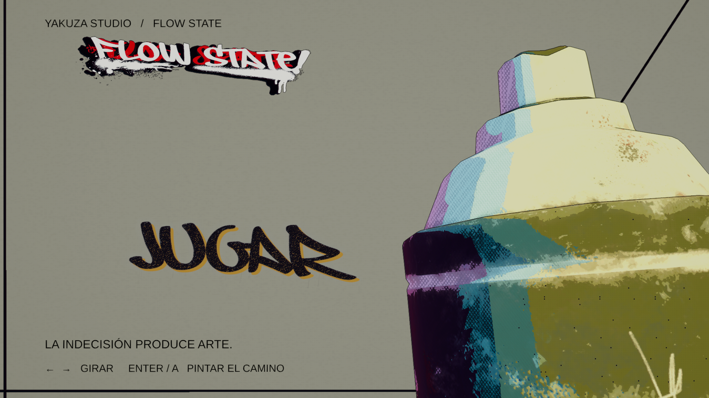

# FLOWSTATE — interfaces, navegación y accesibilidad

Fecha: 2026-10-28. Alcance: auditoría estática, lectura visual de capturas guardadas y creación de skill; no se ejecutó el juego ni se modificaron sus recursos. Proyecto Unity 6000.0.41f1, URP 17.0.4, uGUI 2.0.0, Input System 1.13.1 y Timeline 1.8.7 confirmados en ProjectVersion/Packages. ProjectSettings declara activeInputHandler 2 (Both).

## Evidencia y autoridad

IMPLEMENTADO significa encontrado en código/recurso; CONFIGURACIÓN SERIALIZADA describe un archivo, no resultado runtime. OBSERVACIÓN HISTÓRICA describe una captura guardada; INTERPRETACIÓN/HIPÓTESIS no son pruebas de comprensión. PROPUESTA permanece sin aprobación. Creative Direction conserva identidad y autoridad, Game Design reglas/experiencia, Art & Lighting coherencia visual; UI/UX resuelve presentación, flujos y accesibilidad.

**Límite actual:** MCP respondió instance_count 0 y no_unity_session; Computer Use no encontró una app/ventana Unity entre las aplicaciones consultadas; CLI devolvió EDITOR_NOT_RUNNING para FLOWSTATE. No se abrió Unity para evitar inicialización/importación y cambios fuera del encargo. Por tanto no hay captura nueva ni interacción observada en esta tarea. Las herramientas desconectadas no se describen como verificadas operativamente ahora.

El [snapshot serializado](Serialized-UI-Snapshot-2026-10-28.json) se extrajo por lectura YAML de MainMenu_FlowState, Gameplay, DrawPaintMenu y StreetReputationMenu, resolviendo scripts por GUID/meta. Guarda componentes seleccionados, transforms, navegación, referencias y overrides pertinentes. No reproduce inicialización, herencia completa de todos los prefabs ni visibilidad efectiva. Los overrides de geometría de prefabs ajenos a UI se omitieron; su cantidad se conserva. Buscar por path/type en vez de cargar el JSON entero.

## Arquitectura existente que preservar

| Interfaz | Recursos/propietarios reales | Hallazgo y límite |
|---|---|---|
| Principal | [MainMenu_FlowState.unity](../../../Assets/02_Escenas/MainMenu_FlowState.unity), Assets/09_MainMenu/Runtime y Options | Interfaz 3D de lata y palabra pintada, cuatro opciones JUGAR/GALERÍA/CONFIG/SALIR. No es Canvas uGUI convencional |
| Config/galería | [MenuSubmenu.cs](../../../Assets/09_MainMenu/Runtime/MenuSubmenu.cs) | Volumen maestro por pasos de .25, movimiento SÍ/REDUCIDO, volver; tres imágenes de galería referenciadas. No hay evidencia de menú completo de vídeo o rebinding |
| Pausa/ayuda | [PauseMenuController.cs](../../../Assets/01_Scripts/PauseMenuController.cs), menús editables bajo MENÚS - PAUSA Y CONTROLES | Referencias completas de dos raíces y cuatro botones de pausa, dos páginas de ayuda. Fallback constructor solo se usa si faltan raíces |
| Libreta | [QuickGraffitiBook.cs](../../../Assets/01_Scripts/QuickGraffitiBook.cs), [GraffitiQuickPainter.cs](../../../Assets/01_Scripts/GraffitiQuickPainter.cs) | Tres páginas, 14 botones/selectionMarks y anterior/siguiente/cerrar serializados; selecciona obra y cierra. selectionLabel está sin asignar y el código tolera null; no implica que toda información de selección esté ausente |
| Colores/boquillas | [DrawPaintMenu.prefab](../../../Assets/03_Prefabs/DrawPaintMenu.prefab), GraffitiMenuDrawer/DrawMenu/DrawnMenuButton y rueda HSV/value | Interacción espacial por colliders/raycast; cinco GraffitiDrawnMenuButton, rueda/slider de valor, TMP 3D y dos Canvas auxiliares. No se arregla añadiendo navegación uGUI solamente |
| HUD de recursos | [SprayResourceHUD.cs](../../../Assets/01_Scripts/SprayResourceHUD.cs), SprayResourceSystem, GraffitiPainter | Se crea/bindea al iniciar si falta; muestra pintura/mezcla, porcentajes y aviso de acción. Los mockups antiguos pueden desactivarse |
| Contexto/modo | GraffitiRaycastUI, GraffitiModeHudVisibility y GraffitiQuickPainter | Detección/alcance, entrada a pintura, modo libre/rápido y ocultación/restauración de hints según contexto |
| Reputación | [StreetReputationMenu.prefab](../../../Assets/Resources/UI/StreetReputationMenu.prefab), [ReputationUI.cs](../../../Assets/01_Scripts/Reputation/ReputationUI.cs) | Overall y tres ejes, barras/valores, close callback y transición. Prefab startClosed=true; instancia de Gameplay sobrescribe startClosed=0, pero raíz está inactiva. No se encontró ruta de apertura en los propietarios buscados; acceso runtime pendiente |

### Datos serializados frente a ejecución

Gameplay contiene 44 Canvas/CanvasScaler/GraphicRaycaster explícitos y 134 TMP UGUI, 26 Button, dos Slider y un EventSystem/InputSystemUIInputModule en la lectura; hay además 263 PrefabInstance que no equivalen a 263 interfaces. Muchos Canvas son graffiti en World Space. Estas cantidades no son elementos visibles simultáneamente ni prueba de coste excesivo.

Pausa, ayuda y libreta tienen CanvasScaler ScaleWithScreenSize, referencia 1920×1080 y match .5. CONTROLES CANVA usa ConstantPixelSize. Eso merece comprobación por resolución, sin cambiarlo por defecto ni declarar defecto por su existencia. Las raíces PauseMenu y ControlsMenu figuran activas en archivo, pero Awake las desactiva: no demuestra solapamiento en juego.

Hay 102 referencias TMP UGUI a SpaceGrotesk-Bold SDF, 26 a owned SDF y seis a LiberationSans en los componentes explícitos de Gameplay. La jerarquía usa OWNED expresivo para títulos/gestos y SpaceGrotesk para instrucciones. Estos conteos no cubren automáticamente todo TMP de prefabs instanciados.

MainMenuController tiene cuatro OptionData válidos y legend=null. La captura histórica muestra una leyenda, posiblemente dibujada mediante otros recursos; null no demuestra leyenda ausente. El texto `Editor preview · replaced by actual spray in Play` contiene JUGAR; Prepare lo oculta y el menú pinta la palabra real. El PlayableDirector de la intro está presente; no significa que todas las transiciones UI dependan de Timeline. Pausa/HUD/libreta se animan principalmente por código/coroutines, no por un Animator de menú identificado. No se encontró dependencia de DOTween/LeanTween en las búsquedas de código realizadas.

## Lenguaje visual y capturas

**OBSERVACIÓN HISTÓRICA:** [MainMenuPreview.png](../../AI/MainMenuPreview.png), 1920×1080, muestra papel, logo graffiti, palabra JUGAR impresa, lata grande a la derecha y leyenda inferior. La lata recortada es una decisión documentada de encuadre, no clipping accidental demostrado. La imagen no prueba el estado actual ni todos los submenús. [Docs/AI/MainMenu.md](../../AI/MainMenu.md) registra intención y validaciones históricas; sus asociaciones antiguas de emociones difieren del controlador actual y no se copian como autoridad vigente.

La [captura anterior del viewport de UI](../ArtLighting/Captures/Editor-Initial-UI-2026-10-28.png), obtenida en la tarea de Art & Lighting, muestra fragmentos de papel/cinta/títulos OWNED y fondo cromático. Está recortada por Scene View: no se usa para declarar botones fuera de pantalla ni layout defectuoso en Game View. No hay imagen actual del HUD generado en funcionamiento; su apariencia descrita a continuación procede de código, no de observación directa.

**IMPLEMENTADO:** el HUD construye paneles tinta/papel, pintura amarilla/ácida, mezcla cian, aviso crítico rojo, lata holográfica y ecos magenta/cian. Esa elección se alinea con la impresión FSSRS; no necesita sustituirse por UI genérica. Materiales de UI, TMP y meshes 3D tienen rutas de rendering distintas del mundo; una captura directa MainCamera puede omitir overlays. Evaluar UI completa requiere Game View/pantalla y estado reales.

## Input, estados y accesibilidad

- **Menú principal:** [MenuInput.cs](../../../Assets/09_MainMenu/Runtime/MenuInput.cs) clona el mapa UI del InputSystem_Actions del proyecto. Navigate/Submit/Cancel, rueda/clic y controles de mando están implementados; el stick derecho se separa como mirada ambiental. Consume skip antes de habilitar confirmación y espera liberación de input. MainMenuController conserva cola acotada a cuatro y confirmación pendiente durante giro/pintura. SALIR requiere segunda confirmación durante cinco segundos. Todo esto está en código; no se probó interacción ahora.
- **Gameplay uGUI:** un módulo InputSystemUIInputModule está serializado y referencia DefaultInputActions del paquete Input System (GUID ca9f5fa95ffab41fb9a615ab714db018), distinto del mapa privado del menú principal. Pausa tiene navegación explícita y foco inicial en VOLVER; libreta asigna foco a una obra. No se presume soporte integral de mando: abrir/cerrar, rueda, pintura y raycasts siguen usando muchas entradas legacy Q/E/B/Escape/ratón.
- **Pausa:** guarda/restaura timescale/cursor/audio, cancela pintura y suspende input FPS. Transición de cierre de .18 segundos reales. Otra capa de gameplay puede reservar Escape; ayuda B abre/cierra según contexto. Abrir libreta bloquea canMove y painter.menuOpen; no demuestra pausa del mundo/audio.
- **Aprendizaje:** existen dos páginas de ayuda y hints editables. GraffitiRaycastUI distingue detección de pared del rango real de pintura; el prompt de entrada desaparece dentro del modo. La presencia de ayuda no demuestra que un jugador nuevo comprenda el ciclo libre/rápido, recursos o controles contextuales.
- **Movimiento reducido parcial:** MenuSubmenu guarda FS.Menu.Motion y normaliza reducido a .6; CanMotion, MenuCameraFeedback, MenuBackdropMotion y PunkMenuMotion/Button tienen consumidores. SprayResourceHUD usa animateHud/comicMotion sin leer esa preferencia. Además algunos términos de movimiento de shader dependen de agitado/spray/offsets; animateHud=false no demuestra reposo completo. MenuSubmenu.AnimateOpen no aplica esa escala a su pop/rotación; ReputationUI tiene su transición propia. No se declara que todos estos efectos sean incómodos sin observación/playtest.
- **Recursos y feedback:** HUD usa dos barras y porcentajes, con estado CAMBIANDO LATA, CAMBIAR LATA, AGITANDO o AGITAR en prioridad. Existen ShakeNormalized/CanChangeNormalized/HasCanAvailable en SprayResourceSystem; el HUD inspeccionado no muestra progreso de duración ni consulta disponibilidad al redactar CAMBIAR LATA. infiniteCanSupply=true es default; el caso sin stock es un riesgo condicional, no un fallo observado en Gameplay.

El [shader holográfico de la lata HUD](../../../Assets/Resources/UI/HUD/HolographicSprayCan.shader) calcula tiempo con `_Time.y * (0.38 + _Motion * 0.2)` y lo usa en barrido, scan y foil. Incluso `_Motion=0` conserva reloj base. Junto con offsets de ecos y agitado en el código, esto impide certificar un modo estático apagando únicamente animateHud. Es un hallazgo de lógica, sin prueba de su intensidad perceptual actual.

### Revisión independiente del flujo de libreta

Una evaluación separada, sin leer las conclusiones de este informe, contrastó QuickGraffitiBook, GraffitiQuickPainter y PauseMenuController. **Código comprobado:** Refresh de libreta sitúa foco en la primera obra de página, no necesariamente en la equipada; cerrar bloquea iniciar pintura en ese mismo frame. La pausa/ayuda limpia selección al cerrar y restaura Canvas ocultados, pero no repone expresamente el foco anterior de la libreta. **Hipótesis pendientes:** pérdida de foco al retornar de ayuda sobre libreta y doble efecto de flechas —página por código y navegación del módulo UI— según bindings/contexto efectivo. No se presentan como bugs runtime reproducidos. Una futura intervención debe conservar las protecciones actuales y probar retorno al contexto, sin convertir Escape en una regla nueva sin decisión de diseño.

## Tres propuestas concretas — no implementadas ni aprobadas

### 1. Salida informada desde pausa, conservando su papel y navegación

**Problema/evidencia:** GoToMainMenu restaura estado y llama LoadScene inmediatamente; QuitGame también actúa directamente. El principal ya tiene confirmación propia de SALIR. No se observó pérdida accidental real, pero existe diferencia de protección entre flujos. **Hipótesis UX:** una decisión breve antes de abandonar el recorrido reduciría salidas involuntarias.

**Experiencia:** seguir pintando con confianza y comprender cuándo se deja el recorrido. **Solución visual/funcional propuesta:** confirmación compacta de papel/tinta dentro de pausa, con «Seguir aquí» como foco inicial y «Volver al menú» como acción explícita; Escape cancela y restaura foco al botón de origen. No añadir guardado ni afirmar que la obra está guardada. El texto sobre consecuencias debe acordarse tras verificar qué datos se conservan; reputación persistente no prueba persistencia de pintura del mundo.

**Reutilización:** Canvas/CanvasGroup, TMP, buttons, navegación explícita, PunkMenuButton/Motion y restauración de PauseMenuController. Reutilizar lenguaje de confirmación del principal como referencia, sin conectar su controlador 3D al Canvas de pausa.

**Riesgos:** doble Submit, clic que atraviesa panel, input que se filtra a gameplay, foco perdido y espera de transición con timescale=0. Coste gráfico previsto pequeño, pero no medido; evitar otra capa fullscreen holográfica innecesaria.

**Criterios y comprobación:** cancelar no cambia escena, cursor/audio/timescale permanecen en pausa; confirmar carga una sola vez; reanudar conserva bloqueos anteriores; foco visible con teclado/ratón y mando donde el flujo esté conectado. Capturas de pausa→confirmación→cancelación a resoluciones objetivo. Test funcional de doble entrada/restauración; playtest registra abandonos accidentales y comprensión de consecuencias. Umbrales pendientes de acordar, sin prometer una tasa de mejora.

### 2. Feedback de duración y causa en el HUD de graffiti

**Problema/evidencia:** SprayResourceHUD muestra «AGITANDO» o «CAMBIANDO LATA», pero no utiliza los progresos normalizados existentes. Hay barras/porcentajes de estado, no un indicador del tiempo de la acción. Esto no demuestra que se perciba como lento: **hipótesis** de incertidumbre que necesita observación.

**Experiencia:** comprender qué acción está ocurriendo, cuándo termina y por qué se necesita, sin apartar atención del muro. **Solución propuesta:** conservar lata/paneles actuales y añadir un pequeño progreso temporal junto al aviso activo; explicar brevemente que agitar recupera mezcla y cambiar lata repone pintura. Mantener datos de pintura/mezcla separados del progreso de acción, sin otra barra que parezca un tercer recurso. Si se habilita stock finito, mostrar indisponibilidad real en lugar de pedir acción imposible.

**Reutilización:** ShakeNormalized, CanChangeNormalized, IsShaking, IsChangingCan, HasCanAvailable y teclas configuradas del recurso; warning, TMP y espacio existente del HUD. No cambiar duraciones/consumo, agregar stock o reemplazar el HUD runtime por un mockup serializado.

**Riesgos:** confundir tres magnitudes, tapar obra/boquilla, demasiadas actualizaciones de layout/texto o movimiento adicional. Lectura en fondos claros/oscuros y mezcla de CanvasScaler con escala local requiere prueba; no se propone ahorro de rendimiento sin medición.

**Criterios y comprobación:** estado/progreso corresponden al propietario, regresan correctamente al terminar/cancelar según reglas actuales, ninguna advertencia prescribe acción imposible en los casos habilitados. Capturas normales/críticas/agitado/cambio en A/B con iguales datos y tiempo; QA de transiciones/pausa y resoluciones. Playtest sin instrucciones previas: identificar acción, necesidad y finalización; registrar errores/ayudas, no solo pulsación correcta.

### 3. Movimiento reducido coherente y ayuda que conserve feedback

**Problema/evidencia:** preferencia FS.Menu.Motion tiene consumidores concretos, pero no gobierna HUD completo ni todas las aperturas; existen ayuda textual y tipografía legible reutilizables. **Hipótesis:** una modalidad coherente facilitaría leer/recordar controles sin perder el gesto gráfico. No se certifica malestar ni accesibilidad resuelta.

**Experiencia:** personalizar movimiento y seguir reconociendo foco, estado y acción. **Solución propuesta:** definir con el desarrollador el alcance de REDUCIDO actual y, si procede, una opción de mayor reducción. Conectar los componentes de interfaz incluidos en ese alcance, cubriendo transforms, ecos, materiales, pop y pulsos pertinentes. Mantener la configuración .6 actual hasta aprobar otra semántica. Conservar indicadores estáticos de selección y avisos de agitar/cambiar; facilitar acceso a la ayuda existente con instrucciones ligadas al estado y tamaño de texto verificable. No hace falta diseñar otro tutorial completo.

**Reutilización:** MenuSubmenu, PlayerPrefs existente, PunkMenuMotion/Button, animateHud/comicMotion y páginas SpaceGrotesk de ayuda; cualquier contrato compartido nuevo sería una implementación futura acotada, no una decisión ya tomada. Cambiar textos a glifos de mando no implementa acciones de pintura ausentes.

**Riesgos:** apagar feedback útil, movimiento residual en shader/cámara, preferencia solo aplicada al arrancar y lecturas inconsistentes entre escenas; expansión accidental a todo gameplay. Rendimiento y comodidad requieren pruebas separadas.

**Criterios y comprobación:** matriz preferencia×pantalla×entrada, registrar qué se reduce y qué se conserva. Clips antes/después con mismos datos/acción —PNG no demuestra reducción temporal—, pausa y reentrada incluidas. Prueba funcional de persistencia/aplicación y de foco sin animación; playtest con tareas de aprender libre/rápido y recuperar mezcla, registrando ayudas/errores y comodidad reportada. Los valores candidatos y la política de accesibilidad requieren aprobación.

## Capacidades, herramientas y límites

La skill añade criterio de jerarquía/IA, flujos, estados, HUD, iconografía, tipografía, adaptación, animación, accesibilidad y producción Unity. Las skills oficiales de UI/uGUI y las tres disciplinas del proyecto siguen siendo complementarias, no reemplazadas.

**Verificado en esta tarea:** lectura estática de fuentes/escenas/prefabs, GUIDs y overrides pertinentes, observación de capturas históricas, creación/validación documental. **Disponible pero pendiente de conexión/prueba:** MCP/CLI/Computer Use para inspección y cambios reales autorizados. **Pendiente:** snapshots vivos, nuevas capturas de pantallas, interacción, mando físico, accesibilidad con usuarios, resoluciones reales y profiling. No se usó la falta de instancia para instalar paquetes o modificar configuración.

Existen suites de menús con dispositivos virtuales, spam/cancelación/transición y tests de QuickGraffiti/GraffitiInteraction. Se identificaron fuentes, sin ejecutarlas ni ratificar resultados históricos de Docs/AI. Un test de mapa de input no demuestra que toda interfaz sea intuitiva o jugable con mando.
